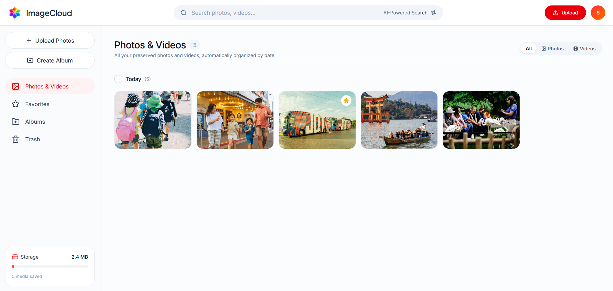
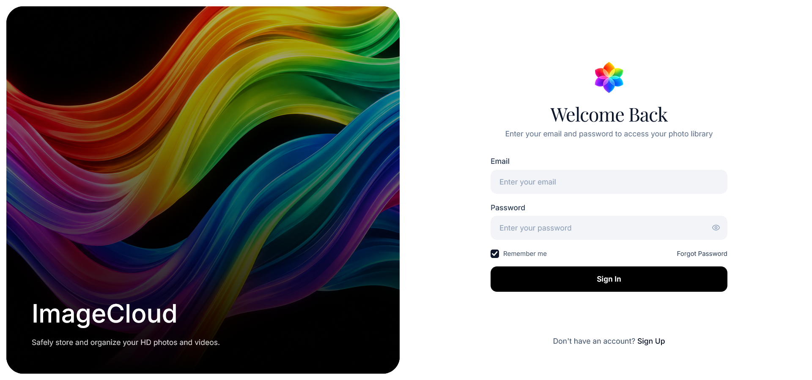
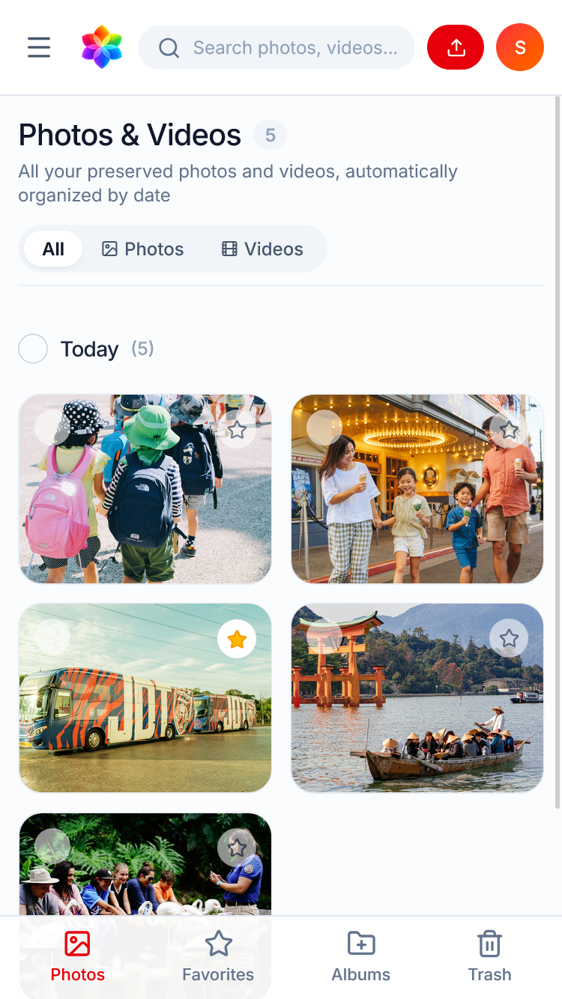

# 📸 ImageCloud — AI-Powered Smart Photo & Video Organizer

<p align="center">
  
</p>

<p align="center">
  <b>A modern, high-performance full-stack MERN cloud photo and video organizer featuring AI-driven auto-tagging, universal Apple HEIC conversion, smart albums, live storage analytics, and a native mobile-first progressive experience.</b>
</p>

<p align="center">
  <a href="https://react.dev/"></a>
  <a href="https://vitejs.dev/"></a>
  <a href="https://tailwindcss.com/"></a>
  <a href="https://nodejs.org/"></a>
  <a href="https://expressjs.com/"></a>
  <a href="https://www.mongodb.com/atlas"></a>
  <a href="https://cloudinary.com/"></a>
  <a href="https://vercel.com/"></a>
</p>

---

## 🖼️ Application Showcase

<p align="center">
  
</p>

<p align="center">
  <em>Desktop Timeline & AI-Powered Gallery Dashboard</em>
</p>

<br />

<table align="center" width="100%">
  <tr>
    <th width="65%" align="center">🔐 Split-Screen Authentication & Security</th>
    <th width="35%" align="center">📱 Native Mobile Experience</th>
  </tr>
  <tr>
    <td align="center" valign="top">
      
      <br />
      <em>Centered branding, JWT Sign In, and 6-digit OTP password recovery</em>
    </td>
    <td align="center" valign="top">
      
      <br />
      <em>Bottom navigation dock, touch-friendly card selection, and responsive layout</em>
    </td>
  </tr>
</table>

---

## 🌟 Key Features

### 🧠 1. AI-Powered Object Detection & Semantic Search
- Integrated with **Google Auto-Tagging** via Cloudinary upload stream to identify visual contents (e.g., *car, dog, sunset, nature, people*).
- Lowercased tags are indexed in MongoDB (`objects: [String]`) for sub-millisecond case-insensitive regex search.
- Graceful subscription fallback: seamlessly uploads media even if third-party AI auto-tagging add-on is disabled.

### 🍏 2. Universal Apple HEIC/HEIF Support
- Upload `.heic` and `.heif` images directly from iPhones, iPads, and Mac computers.
- Overcomes Windows / browser MIME-type limitations with specialized extension filtering.
- Automatically converted to universal high-quality JPEGs in the cloud so photos render across all browsers (Chrome, Edge, Firefox, Safari) without broken image placeholders.
- Client modal displays a sleek dedicated **HEIC preview card** prior to upload.

### 🎬 3. Rich Media Gallery & Interactive Lightbox
- **Timeline Date Grouping**: Organizes visual memories into *Today*, *Yesterday*, or formatted calendar days.
- **Video Support**: Real-time streaming for MP4, MOV, and WebM videos with auto-generated thumbnail posters.
- **Full-featured Lightbox**: Fullscreen modal viewer with keyboard navigation (`Left`, `Right`, `Escape`), media metadata drawer, one-click download, and quick favorite/trash actions.

### 📁 4. Custom Albums & Story Curation
- Group photos and videos into custom albums with titles and descriptions.
- Dynamic cover previews generated from the first album asset.
- Bulk-add photos directly from selection bars or inside album detail views.

### 📱 5. Mobile-First Responsive Experience
- **Dedicated Bottom Navigation Bar**: Quick one-thumb access to *Photos*, *Favorites*, *Albums*, and *Trash* on smartphones.
- **Touch-Friendly Controls**: Pre-visible action buttons on cards (`opacity-70`) so touchscreen users can select or favorite without needing desktop mouse hover.
- Responsive modals and sliding navigation drawer with smooth backdrop blur.

### 📊 6. Real-Time Storage Usage Analytics
- Visual storage consumption card tracking used megabytes (`MB`) against quotas.
- Breakdown of stored media counts (*Total Media*, *Photos*, *Videos*).

### 🔐 7. Secure Authentication & Data Privacy
- JSON Web Token (**JWT**) bearer authentication with token expiration management.
- **BcryptJS** password hashing (salt rounds: 10).
- Strict user-ownership isolation: each user only sees and manages their own media library and albums.

---

## 🏗️ Architecture & Data Flow

```
┌────────────────────────────────────────────────────────┐
│              Client (React 19 + Vite)                  │
│   • Tailwind CSS v4 UI         • AppLayout / Router    │
│   • Axios Auth Interceptors   • Responsive Mobile Nav  │
└───────────────────────────┬────────────────────────────┘
                            │  HTTPS / REST API
                            ▼
┌────────────────────────────────────────────────────────┐
│            Backend (Node.js + Express 5)               │
│   • Vercel Serverless Function Engine                  │
│   • Multer Memory Stream Buffer                        │
│   • JWT Auth Middleware                                │
└─────────────┬───────────────────────────┬──────────────┘
              │                           │
              │ Upload Stream             │ Document Persistence
              ▼                           ▼
┌──────────────────────────┐  ┌──────────────────────────┐
│        Cloudinary        │  │      MongoDB Atlas       │
│  • Google Auto-Tagging   │  │  • Users Collection       │
│  • HEIC -> JPG Transform │  │  • Media Collection       │
│  • Video CDN Delivery    │  │  • Albums Collection      │
└──────────────────────────┘  └──────────────────────────┘
```

---

## 🛠️ Tech Stack

| Category | Technologies |
|---|---|
| **Frontend** | React 19, Vite 8, Tailwind CSS v4, Lucide React, Axios, React Router v7, React Hot Toast |
| **Backend** | Node.js, Express.js 5, Multer, Cloudinary SDK v2, Mongoose 9, JWT, BcryptJS, CORS |
| **Database** | MongoDB Atlas (Cloud Database with Compound Indexing) |
| **Cloud CDN** | Cloudinary Media Platform (Image & Video Transformations, AI Tagging) |
| **Deployment** | Vercel (Frontend SPA + Serverless Node.js Backend Functions) |
| **SEO & AEO** | Schema.org JSON-LD (`WebApplication`, `FAQPage`), XML Sitemap, Robots.txt |

---

## 📂 Project Structure

```
ImageCloud/
├── client/                         # Frontend Application (Vite + React)
│   ├── public/
│   │   ├── favicon.svg             # Application Favicon
│   │   ├── logo.png                # Brand Logo Asset
│   │   ├── robots.txt              # Search Engine & AI Crawler Directives
│   │   └── sitemap.xml             # XML Sitemap for SEO Indexing
│   ├── src/
│   │   ├── components/
│   │   │   ├── albums/             # Album Modals & Add Photos Components
│   │   │   ├── common/             # Loading Spinners & Common UI
│   │   │   ├── layout/             # Navbar, Sidebar, AppLayout, Bottom Nav
│   │   │   └── photos/             # PhotoGrid, PhotoCard, Lightbox, UploadModal
│   │   ├── config/
│   │   │   └── api.js              # Axios Instance with JWT Interceptors
│   │   ├── context/
│   │   │   └── context.jsx         # Global Auth & App State Provider
│   │   ├── pages/
│   │   │   ├── albumDetailPage.jsx # Album Contents View & Photos Manager
│   │   │   ├── albumsPage.jsx      # Albums Grid Page
│   │   │   ├── authPage.jsx        # Login & Registration Page
│   │   │   ├── favoritePage.jsx    # Starred Media Page
│   │   │   ├── photosPage.jsx      # Main Timeline Photos & Videos Gallery
│   │   │   └── trashPage.jsx       # Soft-deleted Media Management
│   │   ├── App.jsx                 # Route Declarations & Protected Routes
│   │   ├── index.css               # Tailwind CSS v4 Utility Classes & Styling
│   │   └── main.jsx                # Client Entry Point
│   ├── index.html                  # HTML Shell with SEO Meta & AEO Schema.org
│   ├── package.json
│   ├── vercel.json                 # Vercel SPA Routing Configuration
│   └── vite.config.js
│
├── server/                         # Backend Application (Node.js + Express)
│   ├── config/
│   │   ├── cloudinary.js           # Cloudinary SDK Configuration
│   │   └── db.js                   # Mongoose Connection with Serverless Caching
│   ├── controllers/
│   │   ├── albumController.js      # Album CRUD Operations
│   │   ├── authController.js       # Register, Login, & User Verification
│   │   └── mediaController.js      # Cloudinary Stream Upload, Search, Trash
│   ├── middleware/
│   │   ├── auth.js                 # JWT Authentication Middleware
│   │   └── upload.js               # Multer Multi-file & HEIC Filter
│   ├── models/
│   │   ├── album.js                # Album Mongoose Schema
│   │   ├── media.js                # Media Document Schema with AI Tags
│   │   └── user.js                 # User Schema with Bcrypt Hashing
│   ├── routes/
│   │   ├── albumRoutes.js          # Album API Endpoints
│   │   ├── authRoutes.js           # Auth API Endpoints
│   │   └── mediaRoutes.js          # Media API Endpoints
│   ├── .env.example                # Sample Environment Variables
│   ├── package.json
│   ├── server.js                   # Express Server Entry & Serverless Export
│   └── vercel.json                 # Vercel Serverless Function Configuration
│
└── README.md                       # Complete Project Documentation
```

---

## 🚀 Getting Started

### Prerequisites
- [Node.js](https://nodejs.org/) (version `18.x` or higher)
- [MongoDB Atlas](https://www.mongodb.com/atlas) cluster connection URI
- [Cloudinary](https://cloudinary.com/) account (Cloud Name, API Key, API Secret)

---

### 1. Clone the Repository
```bash
git clone https://github.com/melan-Akash/FullStackPhotoStorageAppDevelopmentinMERNStack.git
cd FullStackPhotoStorageAppDevelopmentinMERNStack
```

---

### 2. Configure Backend Server
Navigate to the `server` directory and install dependencies:
```bash
cd server
npm install
```

Create a `.env` file in the `server` directory:
```env
PORT=3000
MONGO_URI=mongodb+srv://<username>:<password>@cluster0.mongodb.net/ImageCloud
JWT_SECRET=your_super_secret_jwt_key
CLOUDINARY_CLOUD_NAME=your_cloudinary_cloud_name
CLOUDINARY_API_KEY=your_cloudinary_api_key
CLOUDINARY_API_SECRET=your_cloudinary_api_secret
CLIENT_URL=http://localhost:5173
```

Start the backend server in development mode:
```bash
npm run dev
# Server running at http://localhost:3000
```

---

### 3. Configure Frontend Client
In a separate terminal, navigate to the `client` directory and install dependencies:
```bash
cd ../client
npm install
```

Create a `.env` file in the `client` directory:
```env
VITE_BASE_URL=http://localhost:3000
```

Start the frontend development server:
```bash
npm run dev
# Vite dev server running at http://localhost:5173
```

Open `http://localhost:5173` in your browser.

---

## 📡 API Endpoints Reference

### Authentication (`/api/auth`)
| Method | Endpoint | Description | Auth Required |
|---|---|---|:---:|
| `POST` | `/api/auth/register` | Register new user account & sends welcome email | No |
| `POST` | `/api/auth/login` | Authenticate user and issue JWT | No |
| `GET` | `/api/auth/me` | Fetch authenticated user profile | Yes |
| `POST` | `/api/auth/forgot-password` | Generate & email 6-digit verification code (OTP) | No |
| `POST` | `/api/auth/reset-password` | Verify OTP and update password with bcrypt | No |

### Media Management (`/api/media`)
| Method | Endpoint | Description | Auth Required |
|---|---|---|:---:|
| `POST` | `/api/media/upload` | Upload multiple photos, HEIC, or videos to Cloudinary | Yes |
| `GET` | `/api/media` | Fetch media items (supports `?query=` and `?type=`) | Yes |
| `GET` | `/api/media/stats` | Retrieve total bytes, media counts, and quota usage | Yes |
| `PATCH` | `/api/media/:id/favorite` | Toggle favorite status | Yes |
| `PATCH` | `/api/media/:id/trash` | Move item to trash or restore (`{ restore: true }`) | Yes |
| `DELETE`| `/api/media/:id` | Permanently delete media from Cloudinary and DB | Yes |

### Album Management (`/api/albums`)
| Method | Endpoint | Description | Auth Required |
|---|---|---|:---:|
| `POST` | `/api/albums` | Create a new album with optional photos | Yes |
| `GET` | `/api/albums` | Get all user albums with populated photos | Yes |
| `GET` | `/api/albums/:id` | Get album details and associated media | Yes |
| `PATCH` | `/api/albums/:id/add-photos` | Add photos to existing album (`photoIds: []`) | Yes |
| `PATCH` | `/api/albums/:id/remove-photo`| Remove photo from album | Yes |
| `DELETE`| `/api/albums/:id` | Delete album (photos remain safe in library) | Yes |

---

## 🔍 SEO & AEO Optimization

ImageCloud includes state-of-the-art **Search Engine Optimization (SEO)** and **Answer Engine Optimization (AEO)**:

1. **Schema.org JSON-LD Structured Data**:
   - `WebApplication` schema defines software category, pricing, creator, and key technical capabilities.
   - `FAQPage` schema answers specific user queries for AI search agents (**Google Gemini**, **ChatGPT Search**, **Perplexity**, **Claude**).
2. **Open Graph & Twitter Cards**:
   - Pre-configured preview tags with rich image assets for social sharing on WhatsApp, iMessage, Twitter/X, and LinkedIn.
3. **XML Sitemap & Crawler Rules**:
   - `sitemap.xml` lists all primary application routes and media namespaces.
   - `robots.txt` explicitly allows search bots and AI crawlers (`GPTBot`, `PerplexityBot`, `ClaudeBot`, `Google-Extended`).

---

## ☁️ Deployment Guide (Vercel)

ImageCloud is pre-configured with `vercel.json` files in both `client/` and `server/` directories:

### Deploy Backend (`server`):
1. Import the repository in [Vercel](https://vercel.com/).
2. Set the **Root Directory** to `server`.
3. Add the environment variables:
   - `MONGO_URI`, `JWT_SECRET`, `CLOUDINARY_CLOUD_NAME`, `CLOUDINARY_API_KEY`, `CLOUDINARY_API_SECRET`, and `CLIENT_URL`.
4. Click **Deploy**. Vercel will mount `server.js` as a serverless function via `@vercel/node`.

### Deploy Frontend (`client`):
1. Create a second project on Vercel importing the same repository.
2. Set the **Root Directory** to `client` (Framework Preset auto-detects Vite).
3. Add the environment variable:
   - `VITE_BASE_URL` = *(Your deployed backend Vercel URL)*.
4. Click **Deploy**. Vercel routes all SPA client-side requests through `/index.html`.

---

## 📄 License
This project is licensed under the [MIT License](LICENSE).

## 👨‍💻 Author
**Melan Akash**
- GitHub: [@melan-Akash](https://github.com/melan-Akash)
- Repository: [FullStackPhotoStorageAppDevelopmentinMERNStack](https://github.com/melan-Akash/FullStackPhotoStorageAppDevelopmentinMERNStack)
